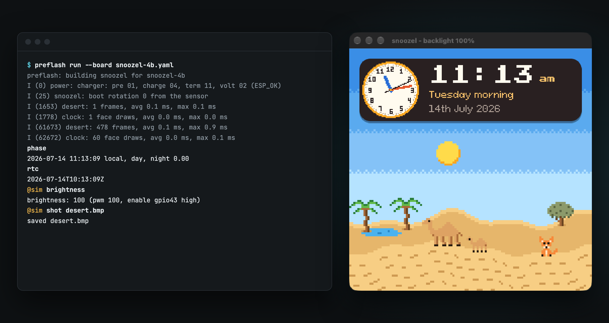
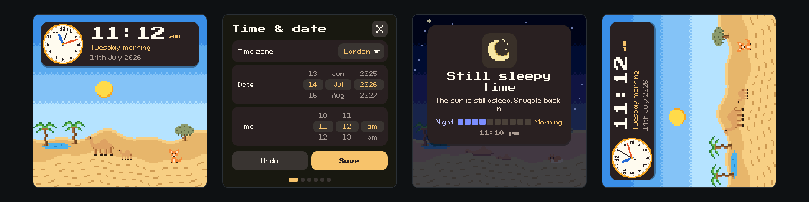

<p align="center">
  <picture>
    <source media="(prefers-color-scheme: dark)" srcset=".github/assets/preflash-mark-on-dark.svg">
    
  </picture>
</p>

<h1 align="center">Preflash</h1>

<p align="center">
  The Xcode Simulator experience, for ESP-IDF boards.
</p>

<p align="center">
  <a href="#quick-start">Quick start</a> ·
  <a href="#how-it-compares">How it compares</a> ·
  <a href="#known-limitations">Known limitations</a> ·
  <a href="#development">Development</a>
</p>

---

You change one line of a screen on an ESP32 board, then wait for a build, wait for a flash and walk over to the device to look. Preflash cuts out the board. It builds your unmodified ESP-IDF project for your Mac and runs it in a window the shape of the board's screen, so your own drivers and UI run while ESP-IDF's services and the board's chips are simulated underneath them.

Use it for quick development and debugging, then test on real hardware before you ship.

<p align="center">
  
</p>

## Why Preflash

- **No firmware changes.** Preflash takes an ESP-IDF project as it is. There's no simulator flag, no fake file and no `#ifdef` to keep in step.
- **Your real drivers run.** Stand-ins replace ESP-IDF's services, and chip models answer on the I2C bus at register level, so your driver code for an RTC, a motion sensor or a power chip runs against something that behaves like the chip.
- **Your own LVGL.** The project's LVGL version builds with the options from its `sdkconfig`, so rendering matches the firmware.
- **Boards are YAML.** A board using known chips needs no tool code. Extend a stock board to describe your own hardware change, or write one from scratch for a custom PCB.
- **It fails loudly.** A call Preflash doesn't implement stops the build or the run and names the call. Firmware never carries on as if it had worked.
- **Scriptable.** Run with no window for CI and coding agents, tap the screen from a script and save what the panel shows.
- **Real network, real saved state.** HTTPS goes out over your Mac's connection, so live APIs work, and what firmware saves survives a restart.

<p align="center">
  
</p>

### What it does today

| Area | Available now |
| --- | --- |
| Display | LVGL 9 through the board's BSP, rotation, backlight dimming on the window |
| Input | Mouse as touch, scripted taps |
| Firmware | FreeRTOS tasks, queues and notifications on host threads, `esp_timer`, the task watchdog, restart |
| Storage | NVS, saved per checkout |
| Console | The firmware's own serial console, in your terminal |
| Chips | PCF85063 RTC, QMI8658 motion sensor and AXP2101 power chip at register level. ES8311, ES7210, TCA9554 and GT911 answer on the bus without a behaviour model |
| Network | Simulated Wi-Fi, SNTP, and real HTTP and HTTPS through `esp_http_client` |
| Audio | The speaker path through `esp_codec_dev`, played on your Mac |
| Boards | ESP32-S3-Touch-LCD-4B, plus your own YAML |

### Coming soon

- **Terminal app.** A status bar over the serial console, shortcut buttons per project, and pickers for board and hardware state.
- **ESP32-S3-Touch-LCD-3.49 V2.** The second stock board, and direct `esp_lcd` use for projects with no BSP.
- **Debug views.** Live I2C, GPIO, task, NVS and network traces, forced hardware failures, and sanitizer builds.
- **Hardware checks.** Chip models compared against captures from real boards.
- **Virtual serial port.** A companion app can talk to the firmware alongside the terminal.

## Install

You need a Mac on Apple Silicon, Go, CMake, Python 3 and SDL2.

```sh
brew install go cmake sdl2
git clone https://github.com/edcs/preflash
cd preflash
go build -o preflash ./cmd/preflash
export PATH="$PWD:$PATH"
```

Keep the checkout, because the binary finds `runtime/` beside its source. Set `PREFLASH_ROOT` to the checkout if you move the binary. There are no packaged releases yet.

## Quick start

Your project needs ESP-IDF 5.x and, if it draws anything, LVGL 9. Run ESP-IDF's own setup once, for the `sdkconfig` and `managed_components` Preflash reads:

```sh
cd my-project
idf.py reconfigure
```

Then run it:

```sh
preflash run --board ESP32-S3-Touch-LCD-4B
```

The window opens with your firmware running, and your terminal becomes its serial console. Click the window to touch the panel. Preflash reads your project and never writes inside it.

```sh
preflash run [--project dir] [--board file] [--headless]
```

`--project` defaults to the current folder. Each checkout gets its own folders, so two copies of one project keep separate saved state:

- `~/.preflash/build/<name>-<hash>` holds the build.
- `~/.preflash/state/<name>-<hash>` holds what firmware saves, such as NVS. Delete it for a factory-fresh device.

### Drive it from a script

Lines starting `@sim ` go to the simulator, and everything else goes to the firmware:

| Line | What it does |
| --- | --- |
| `@sim touch x y [ms]` | Presses the panel, in the panel's own coordinates |
| `@sim shot file.bmp` | Saves what the panel shows |
| `@sim brightness` | Prints the backlight level, and the enable pin if the board has one |
| `@sim audio` | Prints how many sample frames firmware has written to the codec |
| `@sim quit` | Stops the simulator |

`--headless` runs with no window and without starting SDL at all, so it works in CI or on a locked Mac. A headless run ends on `@sim quit`, not at the end of stdin:

```sh
{
  sleep 3
  echo "@sim touch 240 300"
  sleep 1
  echo "@sim shot after-tap.bmp"
  sleep 1
  echo "@sim quit"
} | preflash run --headless
```

To boot firmware at a chosen moment, set `PREFLASH_RTC_START=2026-11-01T22:00:00Z`. The simulated RTC starts there and runs on, and it keeps the firmware's time across a restart.

### Describe your board

A board comes from `--board`, then from `board:` in the project's `.preflashrc`, then the default, `ESP32-S3-Touch-LCD-4B`. Each can be a stock board's name or a YAML file. A path in `.preflashrc` is relative to the project.

A board file can extend a stock board with your own hardware changes:

```yaml
name: my-modded-board
extends: ESP32-S3-Touch-LCD-4B

changes:
  backlight:
    enable: gpio43
```

Or it can stand alone, for a custom PCB whose project uses the same BSP calls. Every chip it lists needs a model in `runtime/src/chips/`, and the run stops and names any that doesn't have one.

```yaml
name: my-board
display:
  controller: st7701
  width: 480
  height: 480
i2c:
  - {chip: pcf85063, address: 0x51}
backlight:
  pin: gpio4
  active_low: true
audio_codec: es8311
```

## How it compares

- **Flashing a real board** is the only test that counts before you ship, and Preflash doesn't replace it. It saves the round trips while you work.
- **Wokwi and QEMU** emulate the chip and run a flashed image, so they get closer to the hardware. Preflash builds native code, so you can step through firmware in your Mac's debugger.
- **ESP-IDF's `linux` target** runs a subset of components natively. It has no `esp_lcd`, I2C, GPIO or Wi-Fi drivers, so a project with a screen and chips doesn't run on it unchanged.
- **LVGL's PC simulators** preview a UI, and you split that UI out of the firmware and write a host `main` yourself. Preflash runs the whole app, including its tasks, storage and drivers.
- **Esprite** is the closest relative. It simulates Arduino projects, where Preflash stands in for ESP-IDF.

## Known limitations

A clean run doesn't prove the hardware will work. Preflash can't show you:

- Real timing, including I2C and task scheduling.
- Stack limits and memory limits, such as internal RAM running out under TLS.
- Tearing, frame rate and real colour on the panel.
- How touch feels.
- A driver bug hidden by a chip model that's wrong. Chip models need checking against the real board.

OTA isn't simulated either. The running slot is always valid, and starting a download fails with a message saying so, so update code stays untested.

With `CONFIG_ESP_TASK_WDT_INIT` set, the task watchdog watches subscribed tasks and stops the process on a panic, where a device would restart. It doesn't watch idle tasks, so an idle task starved of CPU won't trip it. A task can delete itself with `vTaskDelete`, but deleting another task stops the process.

If your firmware stops on a call Preflash doesn't implement, that call needs a stand-in.

## Development

### Test

```sh
make test
```

That runs the Go tests, the runtime suite and the three integration scripts. `tests/integration/snoozel.sh` runs a real project end to end and needs a checkout of it at `../snoozel`, or `SNOOZEL` pointing at one, with a current `sdkconfig`. Snoozel is a private project, so without it run the steps before that script in the `Makefile`.

### Layout

```text
cmd/preflash/     command line
internal/board/   board files: extends, changes and validation
internal/project/ finding, building and running a project
boards/           stock boards
runtime/idf/      the CMake layer that stands in for IDF_PATH
runtime/include/  ESP-IDF headers the firmware compiles against
runtime/src/      stand-ins, chip models, the window and the host
tests/            runtime suite, fixtures and integration scripts
.github/assets/   README images, redrawn by render.sh
```

### Contributing

Commits use conventional commit titles. A new chip means a new model in `runtime/src/chips/`, and a new ESP-IDF call means a stand-in that follows the device's return codes, or that stops and names the call.
