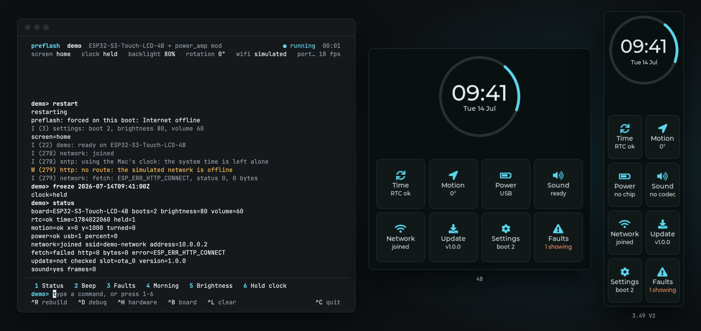
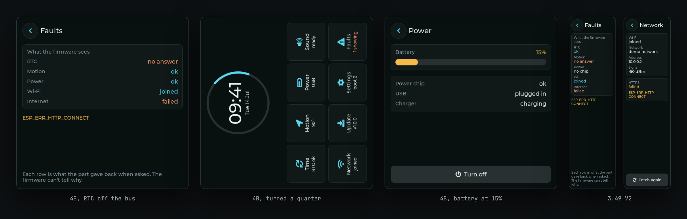
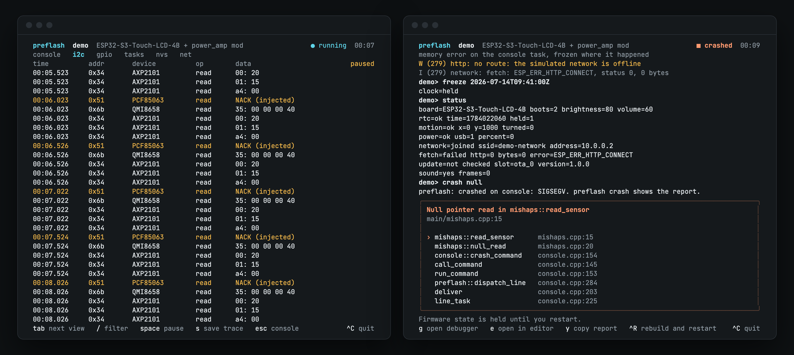

<p align="center">
  <picture>
    <source media="(prefers-color-scheme: dark)" srcset=".github/assets/preflash-mark-on-dark.svg">
    
  </picture>
</p>

<h1 align="center">Preflash</h1>

<p align="center">
  The Xcode Simulator experience, for ESP-IDF boards.
</p>

<p align="center">
  <a href="#install">Install</a> ·
  <a href="#quick-start">Quick start</a> ·
  <a href="#terminal-app">Terminal app</a> ·
  <a href="#drive-it-from-a-script">Scripting</a> ·
  <a href="#debug-firmware">Debugging</a> ·
  <a href="#how-it-compares">How it compares</a> ·
  <a href="#known-limitations">Known limitations</a> ·
  <a href="#development">Development</a>
</p>

---

You change one line of a screen on an ESP32 board, then wait for a build, wait for a flash and walk over to the device to look. Preflash cuts out the board. It builds your unmodified ESP-IDF project for your Mac and runs it in a window the shape of the board's screen, so your own drivers and UI run while ESP-IDF's services and the board's chips are simulated underneath them.

Use it for quick development and debugging, then test on real hardware before you ship.

<p align="center">
  
</p>

Every capture here comes from [`examples/demo`](examples/demo), an ordinary ESP-IDF project in this repo, so you can run what you see. Its [README](examples/demo/README.md) maps each feature to the source that uses it.

## Why Preflash

- **No firmware changes.** Preflash takes an ESP-IDF project as it is. There's no simulator flag, no fake file and no `#ifdef` to keep in step.
- **Your real drivers run.** Stand-ins replace ESP-IDF's services, and chip models answer on the I2C bus at register level, so your driver code for an RTC, a motion sensor or a power chip runs against something that behaves like the chip.
- **Your own LVGL.** The project's LVGL version builds with the options from its `sdkconfig`, so rendering matches the firmware.
- **Boards are YAML.** A board using known chips needs no tool code. Extend a stock board to describe your own hardware change, or write one from scratch for a custom PCB.
- **It fails loudly.** A call Preflash doesn't implement stops the build or the run and names the call. Firmware never carries on as if it had worked.
- **Scriptable.** Run with no window for CI and coding agents, tap the screen from a script and save what the panel shows.
- **Real network, real saved state.** HTTPS goes out over your Mac's connection, so live APIs work, and what firmware saves survives a restart.

<p align="center">
  
</p>

### What it does

| Area | What you get |
| --- | --- |
| Display | LVGL 9 through the board's BSP, or `esp_lcd` directly for a project with no BSP, rotation, backlight dimming on the window |
| Input | Mouse as touch, scripted taps |
| Firmware | FreeRTOS tasks, queues and notifications on host threads, `esp_timer`, the task watchdog, restart |
| Storage | NVS, saved per checkout |
| Network | Simulated Wi-Fi, SNTP, and real HTTP and HTTPS through `esp_http_client` |
| Audio | The speaker path through `esp_codec_dev`, played on your Mac |
| Chips | PCF85063 RTC, QMI8658 motion sensor, AXP2101 power chip, TCA9554 expander and AXS15231B touch at register level. ES8311, ES7210 and GT911 answer on the bus without a behaviour model |
| [Terminal app](#terminal-app) | The firmware's serial console under a status bar, shortcut buttons per project, a board picker, rebuilds that keep the old app on failure, debug views and a hardware panel |
| [Scripting](#drive-it-from-a-script) | A control socket and command line for console lines, status, the serial stream, traces, hardware changes, screenshots and touch |
| [Debugging](#debug-firmware) | Live I2C, GPIO, task, NVS and network traces you can filter and save, forced hardware failures, crash reports tied to source, and address and thread sanitizer builds |
| [Companion apps](#connect-a-companion-app) | A virtual serial port, which also reaches firmware's own USB serial driver |
| [Boards](#describe-your-board) | ESP32-S3-Touch-LCD-4B and ESP32-S3-Touch-LCD-3.49-V2, plus your own YAML |
| [Hardware checks](#check-the-models-against-a-board) | Capture firmware and `preflash check`, which replays a capture against the chip models. No chip has yet been compared with a real board |

## Install

Preflash runs on Apple Silicon Macs. It builds your firmware with CMake and Python 3 and draws the window with SDL2, so install those first:

```sh
brew install cmake sdl2
```

Then install Preflash:

```sh
curl -fsSL https://raw.githubusercontent.com/edcs/preflash/main/install.sh | sh
```

The script downloads the latest release from GitHub and checks its SHA-256. It puts `preflash` in `~/.local/bin` and the runtime it builds firmware against in `~/.local/share/preflash`. If `~/.local/bin` isn't on your `PATH`, add it to your shell's profile:

```sh
export PATH="$HOME/.local/bin:$PATH"
```

Check it worked:

```sh
preflash version
```

### Install options

Set these on the `sh` side of the pipe:

| Variable | Default | Sets |
| --- | --- | --- |
| `PREFLASH_VERSION` | the latest release | which release to install, such as `0.1.0` |
| `PREFLASH_PREFIX` | `~/.local` | where `bin/preflash` and `share/preflash` go |

```sh
curl -fsSL https://raw.githubusercontent.com/edcs/preflash/main/install.sh | PREFLASH_VERSION=0.1.0 sh
```

### Upgrade or uninstall

Run the install command again to upgrade. It replaces the binary and runtime together. Your builds, each project's saved state, such as NVS, and downloaded components stay in `~/.preflash`.

To uninstall, delete what the script installed, and `~/.preflash` too if you want those gone:

```sh
rm -rf ~/.local/bin/preflash ~/.local/share/preflash
rm -rf ~/.preflash
```

### Get the demo

The [quick start](#quick-start) runs the demo app in this repo, so clone it:

```sh
git clone https://github.com/edcs/preflash
cd preflash
```

### Build from source

Building needs Go as well:

```sh
brew install go
go build -o preflash ./cmd/preflash
export PATH="$PWD:$PATH"
```

A binary built this way finds `runtime/` in the checkout it came from. If you move the checkout, rebuild or set `PREFLASH_ROOT` to its new path.

## Quick start

Start with the demo. It needs no ESP-IDF, because the first build downloads the LVGL that its `dependencies.lock` pins, into `~/.preflash/components`:

```sh
preflash --project examples/demo
```

The window opens with the firmware running, and your terminal shows the [terminal app](#terminal-app). Click a tile in the window to touch the panel, and press `1` in the terminal to run the demo's Status shortcut. From a second terminal, take the RTC off the bus and put it back, and watch the Faults page change:

```sh
preflash send --project examples/demo page faults
preflash hardware --project examples/demo i2c pcf85063
preflash hardware --project examples/demo i2c healthy
```

### Run your own project

Your project needs ESP-IDF 5.x and, if it draws anything, LVGL 9. Run ESP-IDF's own setup once, for the `sdkconfig` and `managed_components` Preflash reads:

```sh
cd my-project
idf.py reconfigure
```

A project that commits `sdkconfig` and `dependencies.lock`, as the demo does, skips that step. With no `managed_components/` folder, Preflash downloads what the lock pins and checks each component's hash.

Run `preflash` for the terminal app, or `preflash run` to make your terminal the plain serial console:

```sh
preflash run [--project dir] [--board file] [--headless] [--sanitize address|thread]
```

`--project` defaults to the current folder. Preflash reads your project and doesn't change it. The one exception is a file you ask for, such as a `@sim shot` saved to a path inside it. Each checkout gets its own folders, so two copies of one project keep separate saved state:

- `~/.preflash/build/<name>-<hash>` holds the build.
- `~/.preflash/state/<name>-<hash>` holds what firmware saves, such as NVS. Delete it for a factory-fresh device.

`--headless` runs with no window and without starting SDL at all, so it works in CI or on a locked Mac.

To boot firmware at a chosen moment, set `PREFLASH_RTC_START=2026-11-01T22:00:00Z`. The simulated RTC starts there and runs on, and it keeps the firmware's time across a restart.

## Terminal app

Run `preflash` with no arguments in your project, or `preflash tui`, or pass `--project dir`. `--board`, `--headless` and `--sanitize` work as they do for `preflash run`.

The launch screen lists the board files in your project and the stock boards, with each board's chips and changes. Enter builds and runs, and `s` moves through a plain build and each sanitizer. A project whose `.preflashrc` names a board skips this screen and goes straight to running, as the demo does.

The running screen has a toolbar, the serial console, your shortcuts and an input line. Press a number to run a shortcut while the input is empty, or click its button. The wheel and PgUp/PgDn scroll the console, and up and down walk your history.

| Key | What it does |
| --- | --- |
| `^R` | Rebuilds and restarts, with the build's output in the console. If the build fails, the old app keeps running |
| `^D` | Opens the debug views |
| `^H` | Opens the hardware panel |
| `^B` | Picks another board |
| `^L` | Clears the console |
| `^C` | Quits and stops the app |

<p align="center">
  
</p>

The debug views have a tab each for the console, I2C, GPIO, tasks, NVS and network. Tab moves between them, `/` filters, space pauses, `s` saves the trace to the state folder and esc returns to the console. Tasks and NVS also show a table of what's there now, and a task's stack is the size firmware declared, not what it uses. Rows a forced failure caused show in amber, such as `NACK (injected)`.

The hardware panel changes what [`preflash hardware`](#break-the-hardware) changes, with up and down to choose and left and right to change. It says whether a change applied now or waits for the next boot, and `^R` restarts from the panel.

When firmware [crashes](#when-firmware-crashes), the screen shows the console, the report and these keys:

| Key | What it does |
| --- | --- |
| `g` | Opens `lldb` attached to the frozen app, in this terminal, and returns here when you quit it |
| `e` | Opens `$EDITOR` at the crash's line |
| `y` | Copies the report |
| `^R` | Rebuilds and restarts. If the build fails, the crashed app stays frozen |
| `^C` | Quits and stops the app |

The app runs as a child with its stdin closed and its stdout and stderr in `app.log` in the build folder. The screen reads the serial stream over the control socket, so every `preflash` command still works from a second terminal. If the app stops or crashes, the toolbar says how and the console keeps its last output. The screen takes the mouse, so selecting text in the console needs your terminal's selection modifier. The toolbar shows the serial port last, so a narrow window cuts it off, and `preflash port` prints it in full.

### Set up a project

A `.preflashrc` in the project sets the board, the shortcuts and the status fields. This comes from the demo's [`.preflashrc`](examples/demo/.preflashrc):

```yaml
board: sim/demo-4b.yaml

console:
  prompt: "demo>"

shortcuts:
  - label: Status
    send: status
  - label: Morning
    send:
      - time {today}T07:30:00Z
      - page home
  - label: Brightness
    send: brightness {percent}
    ask:
      percent: 60

status:
  - name: screen
    pattern: 'screen=(\w+)'
  - name: backlight
  - name: rotation
  - name: wifi
```

`send` is one line or a list. `ask` prompts for each value first, with the number given as its default, and `{today}` fills in the local date. A status field shows the last value its pattern found in the serial stream: the first capture group, or the whole match with no group. Backlight, rotation, Wi-Fi and the serial port (`port`) are built in. Naming one with no pattern places it in the toolbar, and naming one with a pattern replaces it. An unknown key stops with an error naming the line, for `preflash run` too.

A project that builds differently per board can name an `sdkconfig` for each one, and any board it doesn't list uses the project's `sdkconfig`. The demo builds different sources for each board:

```yaml
sdkconfig:
  ESP32-S3-Touch-LCD-3.49-V2: sdkconfig.349
```

## Drive it from a script

A running app listens on a private Unix socket, and the `preflash` command talks to it, whether the app has a window or not. Run these from the project, or pass `--project dir` to any of them:

| Command | What it does |
| --- | --- |
| `preflash send <line...>` | Sends a line to the firmware's console and returns without waiting for it to run. Put `--project` before the line |
| `preflash status [--json]` | Shows the project, board, pid, uptime, backlight, rotation, frames, fps, Wi-Fi state and serial port |
| `preflash serial` | Prints the serial stream, starting with what this boot has kept (up to 256 KiB), and follows it through restarts until the app stops |
| `preflash port` | Prints the virtual serial port's path |
| `preflash shot <file.png\|file.bmp>` | Saves what the panel shows |
| `preflash touch x y [ms]` | Presses the panel, in the panel's own coordinates, and returns after the release |
| `preflash trace [--stream x] [--json]` | Prints what firmware does to the hardware, starting with what the app has kept, and follows it through restarts. `x` is `i2c`, `gpio`, `task`, `nvs` or `net` |
| `preflash trace --save file` | Saves what the app has kept as JSON lines |
| `preflash hardware [name value] [--json]` | Shows the board's physical state and forced failures, or changes one |
| `preflash quit` | Stops the app and returns once it has gone |
| `preflash crash [--json]` | Prints the last crash report |
| `preflash bench [--board file]` | Times a clean build, a rebuild, the boot, the frame rate, the socket and the serial stream on a copy of the project |
| `preflash check <capture.jsonl> --board name` | Compares a capture from a real board with the chip models |

`preflash crash`, `preflash bench` and `preflash check` need no running app. With no app running, the others say so and exit 1.

This script opens the demo's Power page and saves it. The numbers are the middle of the Power tile, from the layout in [`page_home.cpp`](examples/demo/main/ui/page_home.cpp):

```sh
cd examples/demo
preflash run --headless < /dev/null &
app=$!
until preflash status > /dev/null 2>&1; do
  kill -0 "$app" 2> /dev/null || exit 1  # the build failed
  sleep 0.2
done
sleep 2  # status answers before the firmware has booted
preflash touch 297 288
sleep 0.5  # touch returns before the firmware has redrawn
preflash shot /tmp/power.png
preflash quit
```

The first run includes the build, so that loop waits for it. For a boot you can see, wait in `preflash serial` for a line your firmware prints, such as the demo's `demo: ready on`, in place of the `sleep`s. Only one app can run per checkout: a second one stops and says which project and pid hold the socket. A headless run ends on `@sim quit` or `preflash quit`, not at the end of stdin.

Stdout and stderr are one stream, as a USB serial port is, so `preflash run` prints both to stdout. A client or terminal that stops reading loses its oldest output and hears how much it lost, and the firmware never waits for it.

`preflash run` reads console lines from stdin. Lines starting `@sim ` go to the simulator, and everything else goes to the firmware:

| Line | What it does |
| --- | --- |
| `@sim touch x y [ms]` | Presses the panel, in the panel's own coordinates |
| `@sim shot file.bmp` | Saves what the panel shows |
| `@sim brightness` | Prints the backlight level, and the enable pin if the board has one |
| `@sim audio` | Prints how many sample frames firmware has written to the codec |
| `@sim quit` | Stops the simulator |

Lines from stdin and `preflash send` join one queue. A console command that never returns holds up the lines behind it, but `status`, `touch`, `shot` and `quit` still work. Quit lets queued lines run first, and stops waiting once a line has gone a second without finishing. The queue holds 1 MiB: past that, `preflash send` fails and a line from stdin is dropped with a message.

## Debug firmware

### Trace what firmware does

`preflash trace` shows what firmware does to the hardware. The demo's [`monitor.cpp`](examples/demo/main/monitor.cpp) reads each chip on a timer:

```text
$ preflash trace --project examples/demo --stream i2c
00:03.024    i2c   0x51 PCF85063            read         04: 31 10 16 02 01 11 26
00:03.024    i2c   0x6b QMI8658             read         35: 00 00 00 40
00:03.024    i2c   0x34 AXP2101             read         00: 20
```

Tracing starts when a client asks for it and stops when the last client leaves, so it costs a running app one relaxed load until then. The app keeps the newest 8192 records in a ring. A client that stops reading loses its oldest records, and firmware never waits for it. `preflash trace` warns of the gap.

NVS rows show keys and sizes and leave the values out, because a value can be a Wi-Fi password. Network rows show whole URLs, query strings included, so check a saved trace before you share it.

### Break the hardware

`preflash hardware` lists each name, its current setting and its choices. `preflash hardware rotation 90` turns the board a quarter clockwise, and your driver reads it from the motion sensor. `preflash hardware i2c pcf85063` makes that chip stop answering, and `preflash hardware i2c all` does the same for the whole bus. The demo's [Faults page](examples/demo/main/ui/page_faults.cpp) shows what firmware sees of each one.

| Name | Choices | Applies |
| --- | --- | --- |
| `rotation` | `0`, `90`, `180`, `270`, as gravity on the QMI8658 | Now |
| `usb` | `plugged`, `unplugged`, through the AXP2101 | Now |
| `battery` | `none`, `100`, `50`, `15`, `0`, through the AXP2101 | Now |
| `internet` | `real`, `offline` | Now |
| `i2c` | `healthy`, `all`, or a chip on the board | Now |
| `wifi_join` | `succeeds`, `fails` | Now |
| `rtc` | `healthy`, `flat`, which sets the PCF85063's OS bit and loses the time | Next boot |
| `motion` | `healthy`, `gone` | Next boot |

The list also has a `wifi` row, which says that the simulated Wi-Fi uses your Mac's connection, and has no other choice. A board shows only the rows its chips can act on, so the 3.49 V2 has no `usb` or `battery`. Preflash refuses to leave the board with no USB and no battery.

Everything you set stays in `faults.json` in the state folder, across restarts, rebuilds and new runs, until you set it back. A boot with anything forced prints what it forced. A flat cell comes back on every boot, including after `esp_restart`, which a real cell wouldn't do.

Firmware that writes the AXP2101's soft power-off bit stops the app, and the next run has USB plugged back in. Forced NACKs happen on the I2C bus, so `esp_io_expander` calls still reach the expander.

### When firmware crashes

Preflash catches a segfault, a bus error, an illegal instruction, an arithmetic fault, a trap and an abort, including `abort()`, a failed `ESP_ERROR_CHECK`, `esp_system_abort`, a watchdog panic and a call Preflash doesn't implement. The failed check prints as it does on a device.

The app saves a report to `crash.json` in the build folder and prints a line on the serial stream. `preflash crash` turns the report into a title, a source line and a call stack, using `dsymutil` and `atos`. The first look at a crash takes a few seconds, while `dsymutil` gathers the debug information. After `preflash send crash null`, which runs the demo's [`mishaps.cpp`](examples/demo/main/mishaps.cpp):

```text
$ preflash crash
Null pointer read in mishaps::read_sensor
main/mishaps.cpp:15
memory error on the console task, SIGSEGV at 0x0

› mishaps::read_sensor      mishaps.cpp:15
  mishaps::null_read        mishaps.cpp:20
  console::crash_command    console.cpp:154
```

With a window, the app stops in place. Firmware's tasks freeze where they were, the window keeps its last frame, and `preflash status`, `shot` and `quit` still work, so you can attach `lldb -p <pid>`. `preflash send` refuses, and ^C or `preflash quit` ends the app. A `--headless` `preflash run` has no frame to keep, so it exits with the signal and a script sees the failure. Under the terminal app, a headless run holds too, so `g` has something to attach to.

Rebuilding replaces the app, so a report older than the build prints addresses in place of names. Only the newest report is kept for each kind of build, and a report stays until the next crash replaces it.

### Run under a sanitizer

`preflash run --sanitize address` finds memory errors and `--sanitize thread` finds data races. Each kind gets its own build folder, so switching costs one build and the plain one stays as it was. Saved state and the socket stay shared.

The first report stops the firmware and counts as a crash, so you read it through `preflash crash` or the crash screen, with the sanitizer's full text at the end. It also goes to the serial stream. Your project's own `ASAN_OPTIONS` and `TSAN_OPTIONS` stay in force, with Preflash's added after them.

A sanitizer build always uses `malloc` and libc's string calls for LVGL, whatever your `sdkconfig` chose, because LVGL's own allocator hides overflows inside its pool. Firmware tasks are real threads, so a race report describes your code running on your Mac, and its timing differs from the chip's.

[`runtime/tsan.supp`](runtime/tsan.supp) lists what the thread sanitizer ignores, with the reason beside each entry. Preflash's own code runs with no suppressions.

## Connect a companion app

`preflash port` prints a path for your app to open as it would a board's serial port, such as `~/Library/Caches/preflash/<hash>.tty`. The path is a link to a pseudo-terminal, and it stays the same from one run to the next. The port carries the serial stream, so your app reads what `preflash serial` shows, and each line it writes joins the console queue, ending in `\n`, `\r` or `\r\n`. Preflash doesn't read your protocol. With the demo running, write `status` to the port and read the answer back.

If your firmware installs the USB serial driver, it owns the wire. Everything your app writes to the port reaches `usb_serial_jtag_read_bytes` byte for byte, `@sim ` lines and line endings included. Lines from stdin and `preflash send` reach it too, each with a `\n`, except `@sim ` lines, which stay with Preflash. Until the driver is in, these lines wait in the queue. Firmware reads serial input through that call, because stdin stays with Preflash.

The port starts raw at 115200 with no echo. Your app keeps its connection through `esp_restart`, and sees the port hang up on quit, on a crash and on a rebuild, as it would when you unplug a board. Open the path again to reconnect.

To put a link where your app's developer setting looks, add one to `.preflashrc`. Preflash removes both links when the app stops, and refuses to replace a file that isn't a link. Only `kill -9` leaves them behind, and the next run replaces them.

```yaml
serial_link: sim/my-board.tty
```

A relative path starts at the project, and `~/` at your home folder. The link's folder must exist already. If a link fails, the app prints why and runs on, and `preflash port` gives the device's own path if there's no other.

The port doesn't appear as a USB device, so an app that finds boards by USB identity needs that developer setting. Firmware never waits for the port. It holds about 65 KiB, and past that it loses the oldest output, with no notice in the stream, because a notice would land in your protocol. An app that opens the port late reads what it's holding first, so expect old lines ahead of live ones, with a gap between them.

## Describe your board

A board comes from `--board`, then from `board:` in the project's `.preflashrc`, then the default, `ESP32-S3-Touch-LCD-4B`. Each can be a stock board's name or a YAML file. A path in `.preflashrc` is relative to the project.

A board file can extend a stock board with your own hardware changes. The demo's [`sim/demo-4b.yaml`](examples/demo/sim/demo-4b.yaml) describes a small rework, and the firmware doesn't change:

```yaml
name: demo-4b
extends: ESP32-S3-Touch-LCD-4B

changes:
  power_amp: exio5
```

Or it can stand alone, for a custom PCB whose project uses the same BSP calls or drives `esp_lcd` itself. Every chip it lists needs a model in [`runtime/src/chips/`](runtime/src/chips), and the run stops and names any that doesn't have one.

```yaml
name: my-board
display:
  controller: st7701
  width: 480
  height: 480
i2c:
  - {chip: pcf85063, address: 0x51}
backlight:
  pin: gpio4
  active_low: true
audio_codec: es8311
```

A few keys cover wiring that differs between boards. The stock `ESP32-S3-Touch-LCD-3.49-V2` uses all but the last:

| Key | What it does |
| --- | --- |
| `display.byte_order` | How `esp_lcd_panel_draw_bitmap` reads RGB565: `le`, the default, or `be` |
| `i2c[].bus` | The `i2c_port` a chip sits on, 0 by default. Firmware on the other bus gets no answer |
| `backlight.enable` | What cuts the backlight when low: a pin, `gpio43`, or a TCA9554 bit, `exio1` |
| `power_amp` | The expander bit behind `BSP_POWER_AMP_IO`, such as `exio3` |

A channel set up with `ledc_channel_config` on the backlight pin sets the brightness, so firmware dims the panel through LEDC as it would on the board. On a stock 3.49 V2 the window shows the bare portrait panel, so firmware that draws in landscape appears on its side. `esp_lcd_new_panel_axs15231b` is the one panel driver Preflash has, and any other stops the build at the missing call. The demo's [`board_349.cpp`](examples/demo/main/board_349.cpp) drives that panel with no BSP, and [`board_4b.cpp`](examples/demo/main/board_4b.cpp) goes through the board package.

## How it compares

- **Flashing a real board** is the only test that counts before you ship, and Preflash doesn't replace it. It saves the round trips while you work.
- **Wokwi and QEMU** emulate the chip and run a flashed image, so they get closer to the hardware. Preflash builds native code, so you can step through firmware in your Mac's debugger.
- **ESP-IDF's `linux` target** runs a subset of components natively. It has no `esp_lcd`, I2C, GPIO or Wi-Fi drivers, so a project with a screen and chips doesn't run on it unchanged.
- **LVGL's PC simulators** preview a UI, and you split that UI out of the firmware and write a host `main` yourself. Preflash runs the whole app, including its tasks, storage and drivers.
- **Esprite** is the closest relative. It simulates Arduino projects, where Preflash stands in for ESP-IDF.

## Known limitations

A clean run doesn't prove the hardware will work. Preflash can't show you:

- Real timing, including I2C and task scheduling.
- Stack limits and memory limits, such as internal RAM running out under TLS.
- Tearing, frame rate and real colour on the panel.
- How touch feels.
- A driver bug hidden by a chip model that's wrong. See [Check the models against a board](#check-the-models-against-a-board).

OTA isn't simulated either. The running slot is always valid, and starting a download fails with a message saying so, so update code stays untested.

With `CONFIG_ESP_TASK_WDT_INIT` set, the task watchdog watches subscribed tasks and a panic counts as a crash, where a device would restart. It doesn't watch idle tasks, so an idle task starved of CPU won't trip it. A task can delete itself with `vTaskDelete`, but deleting another task stops the process.

If your firmware stops on a call Preflash doesn't implement, that call needs a stand-in.

### Checks that need a person

`make test` can't do these, so try them yourself with the demo:

- **A mouse click in the window.** The tests press the panel through the socket. Click a tile with a real mouse and watch the page open.
- **The audible chime.** The tests count the sample frames firmware writes. Press the Beep shortcut and listen.
- **The debug and crash screens with a window open.** The tests run these screens headless. Run the demo with a window, press `^D`, then send `crash null`.
- **`g` in the crash screen.** The tests use a stand-in for `lldb`. Press `g` with the real one and check it attaches.
- **Hardware captures.** These need a board on your desk, as the next section says.

### Check the models against a board

No chip has yet been compared with a real board. The comparison tools exist, and nobody has run them on a chip, so `hardware/captures/` stays empty until someone with the boards does. Everything Preflash has checked so far comes from datasheets, Waveshare's material and synthetic captures, and none of those say a model matches its chip.

[`hardware/capture`](hardware/capture) is an ESP-IDF project with a config for each stock board. It runs a fixed list of driver calls against each chip and prints JSON lines. Its README has the steps to build, flash and save a capture. `preflash check` then sends the same transactions to the models and marks each difference as expected, such as the time or sensor noise, or as a mismatch, and exits 1 on a mismatch. A capture that didn't come from a real chip says `synthetic` in the file, and `preflash check` says so at both ends of its output.

The ES8311, ES7210 and GT911 models answer on the bus and hold no behaviour. Each stays that way until real captures show what it needs, so expect mismatches from them.

## Development

### Test

```sh
make test
```

That runs the Go tests, the runtime suite and the integration scripts, and it needs no other project and no ESP-IDF. `tests/integration/demo.sh` is the main end-to-end test: it runs [`examples/demo`](examples/demo) on both stock boards, drives each page, shortcut, forced failure and crash through the socket, and compares the panel with the frames in `tests/integration/golden/demo/`. Its first lines say how to regenerate them. The test holds the internet offline, so it never reaches a public site, though a clean checkout downloads its dependencies once.

`tests/integration/debug.sh` checks traces and forced failures through a running project. `tests/integration/crash.sh` crashes a project each way, under each sanitizer too, and reads the reports back. `tests/integration/check.sh` runs `preflash check` on hand-written captures and runs the capture firmware under Preflash on both stock boards, so all of it is synthetic. `tests/integration/tui.sh` runs the terminal app in a pseudo-terminal and reads its screen through a virtual terminal, including a mouse click on a shortcut. `tests/integration/lcd.sh` runs a project with no BSP from `tests/fixtures/lcd_project`. The suite also has optional scripts for private projects, and each skips unless its variable points at a checkout.

`make bench` times the demo on a copy of it. `preflash bench --project dir` does the same for a project whose console answers `spew <bytes>` by printing that many bytes and then `spew done`, and prints a table on stderr and JSON on stdout.

### Layout

```text
cmd/preflash/     command line
internal/app/     supervising a build and its app for the terminal app
internal/board/   board files: extends, changes and validation
internal/check/   reading captures and comparing them with the chip models
internal/client/  talking to a running app over its socket
internal/crash/   reading crash reports and tying them to source
internal/project/ finding, building and running a project
internal/rc/      reading .preflashrc
internal/tui/     the terminal app's screens
internal/bench/   timing a project for preflash bench
boards/           stock boards
examples/demo/    a reference ESP-IDF project for both stock boards
hardware/capture/ firmware that records what real chips answer
runtime/idf/      the CMake layer that stands in for IDF_PATH
runtime/include/  ESP-IDF headers the firmware compiles against
runtime/src/      stand-ins, chip models, the window and the host
runtime/replay/   the chip models with a main of their own, for preflash check
tests/            runtime suite, fixtures, integration scripts and terminal tests
.github/assets/   README images, from source/capture.sh and render.sh
```

### Contributing

Commits use conventional commit titles. A new chip means a new model in `runtime/src/chips/`, and a new ESP-IDF call means a stand-in that follows the device's return codes, or that stops and names the call.

## License

Preflash is under the [MIT License](LICENSE), and so are the demo and capture firmware, so you can copy from them into your own projects.
