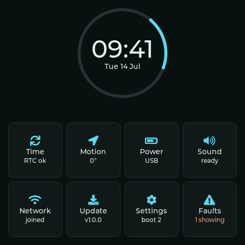

# Demo

A small bench instrument for two Waveshare ESP32-S3 boards. It reads the board's chips, shows the readings on pages you reach by touch, and keeps running when a chip, the Wi-Fi or the internet fails.

It's an ordinary ESP-IDF 5.4 project with LVGL 9. Nothing in `main/` knows about Preflash, so you can read it as a reference for what Preflash runs, and compare it with what the [main README](../../README.md) claims.

<p align="center">
  
</p>

## Run it

From a clean clone, with Preflash built as the main README says:

```sh
preflash --project examples/demo
```

You need no ESP-IDF and no `idf.py reconfigure`. The first build downloads LVGL at the version and hash `dependencies.lock` pins, into `~/.preflash/components`, and leaves this folder alone. The 4B is the default. For the long panel, press `^B` in the terminal app and pick the 3.49 V2, or pass it by name:

```sh
preflash run --project examples/demo --board ESP32-S3-Touch-LCD-3.49-V2
```

From a second terminal, try a forced failure and watch the Faults page change:

```sh
preflash send --project examples/demo page faults
preflash hardware --project examples/demo i2c pcf85063
preflash hardware --project examples/demo i2c healthy
```

## Where each feature lives

| Feature | Source | Try it |
| --- | --- | --- |
| LVGL pages reached by touch | [`ui/ui.cpp`](main/ui/ui.cpp), [`ui/page_home.cpp`](main/ui/page_home.cpp) | Tap a tile, then the back arrow |
| Display and touch through a board package | [`board_4b.cpp`](main/board_4b.cpp) | Run on the 4B |
| Display and touch through `esp_lcd` directly | [`board_349.cpp`](main/board_349.cpp) | Run on the 3.49 V2 |
| Console commands | [`console.cpp`](main/console.cpp) | `preflash send help` |
| NVS settings that survive a restart | [`settings.cpp`](main/settings.cpp), [`ui/page_settings.cpp`](main/ui/page_settings.cpp) | `brightness 30`, then `restart` |
| RTC time | [`rtc.cpp`](main/rtc.cpp), [`timekeeper.cpp`](main/timekeeper.cpp), [`ui/page_time.cpp`](main/ui/page_time.cpp) | `preflash hardware rtc flat`, then `restart` |
| Motion sensor rotation | [`motion.cpp`](main/motion.cpp), [`monitor.cpp`](main/monitor.cpp), [`ui/page_motion.cpp`](main/ui/page_motion.cpp) | `preflash hardware rotation 90` |
| AXP2101 power | [`power.cpp`](main/power.cpp), [`ui/page_power.cpp`](main/ui/page_power.cpp) | `preflash hardware battery 15` |
| Backlight | `set_brightness` in [`board_4b.cpp`](main/board_4b.cpp) and [`board_349.cpp`](main/board_349.cpp) | `brightness 30` |
| Codec audio | [`audio.cpp`](main/audio.cpp), [`ui/page_sound.cpp`](main/ui/page_sound.cpp) | `beep` |
| Wi-Fi join | [`network.cpp`](main/network.cpp), [`ui/page_network.cpp`](main/ui/page_network.cpp) | `preflash hardware wifi_join fails`, then `wifi other` |
| HTTPS fetch | `https_get` in [`network.cpp`](main/network.cpp) | `fetch`, or `preflash hardware internet offline` first |
| SNTP | `start_time_sync` in [`network.cpp`](main/network.cpp) | The Time page after a join |
| OTA check | [`update.cpp`](main/update.cpp), [`ui/page_update.cpp`](main/ui/page_update.cpp) | `update` |
| Timers | `esp_timer` in [`monitor.cpp`](main/monitor.cpp) and [`timekeeper.cpp`](main/timekeeper.cpp) | Readings refresh on their own |
| Task watchdog | [`monitor.cpp`](main/monitor.cpp) | `hang`, then `preflash crash` |
| Deliberate crashes | [`mishaps.cpp`](main/mishaps.cpp) | `crash null`, then `preflash crash` |
| What firmware sees of a forced failure | [`ui/page_faults.cpp`](main/ui/page_faults.cpp) | `page faults` with any failure set |
| Board file with `extends` | [`sim/demo-4b.yaml`](sim/demo-4b.yaml) | `preflash status` names `demo-4b` |
| Shortcuts, status fields, a per-board sdkconfig | [`.preflashrc`](.preflashrc) | Open the terminal app |

The 3.49 V2 has no power chip or codec in its board file, so those pages say so. Its layout only works upright, so the screen follows a half turn and ignores a quarter turn.

The fonts are LVGL's bundled Montserrat. The art is code: a ring, tiles and LVGL's built-in symbols.

## Build it for real

ESP-IDF 5.4 builds both boards. `sdkconfig` holds the 4B's configuration and `sdkconfig.349` the 3.49 V2's. Kconfig's `DEMO_BOARD` choice decides which `board_*.cpp` file `main/CMakeLists.txt` builds. `idf.py` adds `managed_components/` to this folder, which Preflash then uses in place of its download.

```sh
. ~/esp/esp-idf/export.sh
cd examples/demo
idf.py -B build-4b -D SDKCONFIG=sdkconfig \
  -D SDKCONFIG_DEFAULTS="sdkconfig.defaults;sdkconfig.defaults.4b" set-target esp32s3 build
idf.py -B build-349 -D SDKCONFIG=sdkconfig.349 \
  -D SDKCONFIG_DEFAULTS="sdkconfig.defaults;sdkconfig.defaults.349" set-target esp32s3 build
```

Both of these commands rewrite the two `sdkconfig` files from the `sdkconfig.defaults*` files, so change a setting in those and commit what comes out. To change a dependency, edit `main/idf_component.yml` and commit the new `dependencies.lock` too.

Set your network with `CONFIG_DEMO_WIFI_SSID`, or at run time with `wifi <ssid> <password>`, which saves it to NVS.

Nobody has flashed this firmware to a board yet. The builds pass, and the pin numbers and the panel start-up come from Waveshare's material, so expect to check the motion sensor's axes and the panel on real hardware.

## Console

`help` lists every command. These are the ones the tests lean on:

| Command | What it does |
| --- | --- |
| `status` | Prints what the firmware knows |
| `page <name>` | Opens a page |
| `freeze <time>` | Holds the clock at a time such as `2026-07-14T09:41:00Z` and stops the ring, so that two screenshots match. `freeze off` lets go |
| `spew <bytes>` | Prints that many bytes, for `preflash bench` |

`tests/integration/demo.sh` drives this project through every page, shortcut, failure and crash, and compares the panel with the frames in `tests/integration/golden/demo/`.
